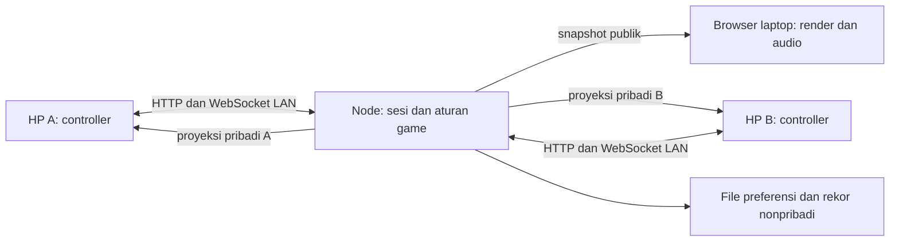

# 04 — Arsitektur

## Pilihan utama

Satu proses server Node.js LTS yang masih didukung, TypeScript untuk kode bersama, Vite untuk build UI, WebSocket untuk LAN. Pilih dan kunci versi dependency pada checkpoint fondasi berdasarkan lingkungan saat itu; spesifikasi ini tidak menetapkan versi terbaru tanpa verifikasi. Lihat [siklus dukungan Node.js](https://nodejs.org/en/about/previous-releases).

UI shell dan controller menggunakan DOM/CSS TypeScript, tanpa framework wajib. Renderer game awal memakai Canvas 2D; Three.js opsional untuk dekorasi katalog atau renderer 2.5D setelah target performa terpenuhi. Tidak perlu database server, Redis, Kubernetes atau layanan cloud. Library calon: `ws` untuk server koneksi, generator QR lokal, schema validator JSON Schema. Evaluasi ukuran, pemeliharaan dan lisensi saat mengunci dependency.

## Tanggung jawab dan aliran



**Server satu-satunya sumber kebenaran.** Simulasi dan timer berjalan di server; browser display tidak menentukan skor, collision atau jawaban. Karena controller dan display melewati server yang sama di laptop, tidak ada kebutuhan sinkronisasi simulasi antar-HP. Terdapat satu display aktif per sesi; membuka display kedua hanya menampilkan petunjuk, tidak mengambil alih diam-diam.

Input → validasi sesi/schema → input state pemain → fixed tick game → snapshot publik/privat → renderer. Tidak merelay pesan controller mentah ke semua perangkat. Operasi file, kompresi besar, pemuatan aset dan logging tidak boleh memblokir tick.

Target awal tick 60 Hz, snapshot display 30 Hz dengan interpolasi satu interval sebagai titik awal. Tambahan delay interpolasi termasuk pengukuran NF-02; jika gagal, evaluasi snapshot 60 Hz atau interpolasi adaptif sebelum memilih WebRTC. Render memakai requestAnimationFrame. Batasi catch-up maksimal lima tick; jeda panjang memicu pause, bukan loncatan simulasi. Gameplay tidak memakai Date.now untuk durasi; gunakan jam monotonic server.

## State machine

Sesi: `setup → lobby → catalog → tutorial → ready → countdown → playing → results → catalog`.

`playing/countdown` dapat masuk `paused` akibat controller/display putus, host pause, atau tick macet. Resume memerlukan display siap, dua controller tersambung dan keduanya Siap; mulai countdown 3 detik dengan semua input netral. Keluar match menghapus state privat dan mengembalikan katalog. Stop server mengakhiri sesi; pemulihan match setelah proses mati tidak dijanjikan v0.1.

Pengelola sesi memisahkan transitionId/gameInstanceId agar event lama dari game sebelumnya ditolak. Menu host dan input gameplay menggunakan mode yang berbeda. Pause tidak menghalangi heartbeat dan proses reconnect.

## Struktur implementasi yang direncanakan

```text
apps/server/          # HTTP, sesi, WebSocket, persistence
apps/console/         # layar laptop dan katalog
apps/controller/      # browser HP
packages/protocol/    # tipe, schema dan versi pesan
packages/game-core/   # scheduler, seed, input, lifecycle
packages/games/       # orbit-duo, garden-duo, seirama
packages/ui/          # komponen dan layout controller
assets/               # aset milik proyek dan inventaris lisensi
tests/                # unit, integrasi, E2E, profil LAN
```

Folder kode tersebut belum dibuat; ini rancangan. Native wrapper/installer menjadi ekspansi setelah alur browser stabil. Distribusi pertama berupa build statis + server yang disertai petunjuk Node. Rilis portable yang menyertakan runtime membutuhkan tes dan audit distribusi sendiri.
