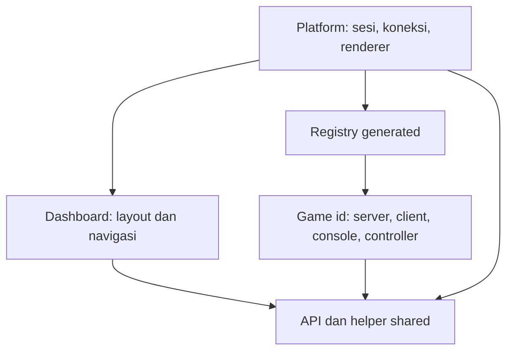

# Kontrak dan batas modul

Game tidak mengimpor game lain atau dashboard. Dashboard tidak mengimpor game; host menyuplai metadata dan fungsi artwork. `shared` tidak mengimpor platform, dashboard, registry atau game. Game boleh membaca kontrak/helper bersama. Tes/tool milik game boleh memakai API host yang didokumentasikan untuk integrasi; bukan menjadikan host dependensi gameplay.

| Path | Pemilik/fungsi |
|---|---|
| `src/dashboard/view.ts`, `style.css` | Menu konsol; tidak ada daftar atau aturan game |
| `src/platform/server.ts` | Sesi LAN otoritatif, pairing, privasi koneksi, antrean input |
| `src/platform/game-runtime.ts` | Dispatch lifecycle melalui registry, waktu dan validasi input |
| `src/platform/app.ts`, `touch-controller.ts` | Shell browser umum dan event/touch transport |
| `src/platform/scene3d.ts` | Renderer/resource aktif; build/update scene didelegasikan |
| `src/shared/game-contracts.ts` | `GameManifest`, `GameServer`, `GameClient`, `SceneKit` |
| `src/shared/renderer/` | Loader/aset CC0 dan resource umum, bukan aturan game |
| `src/shared/math/` | Primitif matematika umum |
| `src/games/<id>/` | Seluruh source, tes, tools, aset dan status game itu |
| `src/generated/` | Output discovery; diabaikan Git dan dibuat ulang |
| `src/*.ts`, `public/style.css` lama | Facade kompatibilitas beku untuk script historis |

`server.ts` game mengekspor adapter default: `create`, `tick`, `action`, `publicState`, `privateState`, `result`; `neutral/controllerReplaced` opsional. Privasi adalah keputusan eksplisit adapter dan harus diuji (Seirama tidak menyebarkan jawaban sebelum reveal).

`client.ts` mengekspor adapter default dengan `buildConsole` dan `controller`, serta hook HUD, display, audio, analog, render key dan developer bila dibutuhkan. Primitive scene berasal dari `SceneKit`, bukan impor console game lain. State live tetap milik pertandingan; jangan menyimpannya dalam registry atau memutasi manifest.

Setiap build menghasilkan entry browser `dist/public/games/<id>/client.js`, entry aturan `dist/games/<id>/server.mjs`, dashboard dan host, dengan chunk ESM bersama. Ini pemisahan program/modul dan bundel dalam satu konsol LAN, **bukan** server/port/OS process terpisah per game atau sandbox untuk plugin tidak dipercaya. Menambah proses/port bukan bagian desain ini.

Discovery membaca semua `src/games/*/manifest.json`, memvalidasi ID/folder, metadata, axis/aksi dan berkas wajib, lalu mengurutkan `order` dan ID sebagai tie-breaker. Tidak ada import/list ID manual pada menu/host. Hasil generated tidak disimpan dalam Git sehingga dua penambahan game tidak berebut satu baris registry. Build membuang output lama sebelum membangun agar game terhapus tidak tertinggal dalam distribusi.
